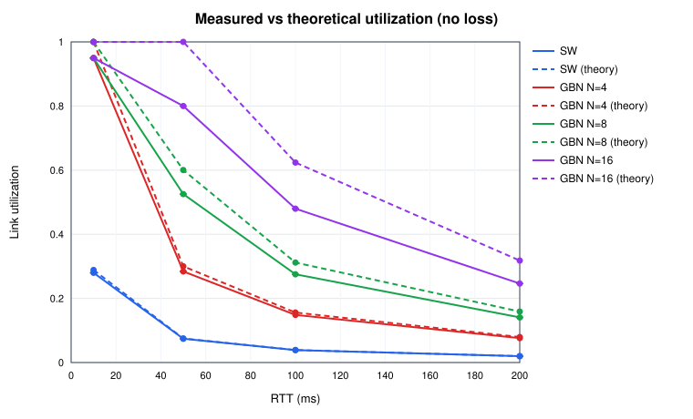
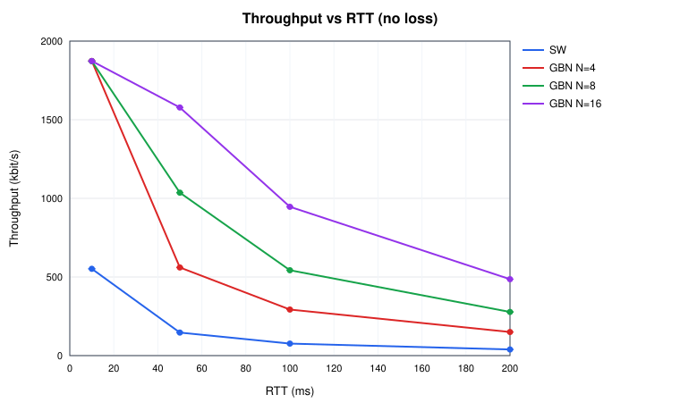
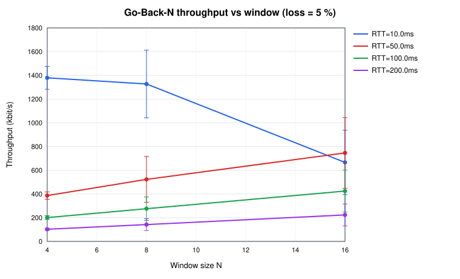
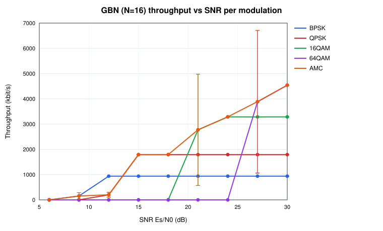

# Results and discussion

All numbers come from the CSV files in [`results/`](../results). They were produced on one machine
(Windows 11, loopback UDP) with `arqsim sweep --preset <name>`.

Common settings, unless a section says otherwise:

* file: 50 000 bytes of pseudo-random data, split into 50 DATA packets with a 1000-byte payload and a 14-byte header (`L` = 1014 B)
* link rate: `R` = 2 Mbit/s, so `L/R` = 4.06 ms
* DATA loss equals ACK loss
* 5 repetitions per configuration. Repetition *r* uses the same seed for every protocol, so all protocols see the same randomness.
* error bars and `±` values are 95 % Student-t confidence intervals

Every one of the more than 1 000 runs was checked end to end: the received size had to match and the SHA-256 had to match the original.
The **integrity** column is 100 % for every configuration except the SNR/modulation pairs below the SNR cliff in §5, where the transfer cannot complete and the run aborts after 10 s without progress.

---

## 1. The proposal's experiment matrix (`results/proposal`, 400 runs)

### 1.1 Loss-free channel: measured vs theoretical utilisation

| Protocol | RTT 10 ms | RTT 50 ms | RTT 100 ms | RTT 200 ms |
|---|---|---|---|---|
| SW (meas / eq. 1)      | 0.280 / 0.289 | 0.074 / 0.075 | 0.039 / 0.039 | 0.020 / 0.020 |
| GBN N=4 (meas / eq. 2) | 0.950 / 1.000 | 0.284 / 0.300 | 0.148 / 0.156 | 0.076 / 0.080 |
| GBN N=8                | 0.949 / 1.000 | 0.525 / 0.600 | 0.275 / 0.312 | 0.141 / 0.159 |
| GBN N=16               | 0.950 / 1.000 | 0.800 / 1.000 | 0.480 / 0.624 | 0.246 / 0.318 |

* **Stop-and-Wait matches equation (1) within 3 %.** The confidence intervals are below 0.5 %, so the emulator's timing is accurate.
* **GBN follows equation (2) and saturates once `N·L/R ≥ RTT + L/R`.**
  The remaining gap comes from the finite file. Eq. 2 describes steady state, but a 50-packet transfer always pays one extra RTT for the last ACK.
  A finite-file model `T ≈ n·L/R + RTT` predicts 0.80 for N=16 at RTT = 50 ms, and we measured exactly 0.800.
* At RTT = 10 ms all windows reach about 0.95. The link is the bottleneck: 1.87 Mbit/s of goodput out of 2 Mbit/s, the difference being the 14-byte header.

### 1.2 Throughput vs RTT and window

SW throughput falls as `1/RTT`: 552 → 146 → 76 → 39 kbit/s.
At RTT = 200 ms, GBN with N=16 is **12.5×** faster than SW (486 vs 39 kbit/s).
Throughput grows with N until the window covers the bandwidth-delay product, as predicted by the proposal (§6).

### 1.3 Effect of loss (RTT = 50 ms)

| loss | SW kbit/s (retx) | GBN N=4 | GBN N=8 | GBN N=16 |
|---:|---|---|---|---|
| 0 %  | 146 (0)   | 560 (0)    | 1036 (0)   | 1578 (0) |
| 1 %  | 138 (1.6) | 514 (2.4)  | 856 (5.4)  | 1257 (9.6) |
| 5 %  | 123 (5.4) | 385 (8.8)  | 521 (21.8) | 744 (28.6) |
| 10 % | 102 (12.4)| 255 (24.4) | 285 (55.8) | 337 (90.8) |
| 20 % | 71 (29.8) | 154 (55.4) | 193 (101)  | 232 (165) |

* GBN keeps a throughput advantage at every loss rate, but **the advantage shrinks from 10.8× to 3.3×**.
  The cost is efficiency: at 20 % loss, GBN N=16 sends 3.3 packets for every useful one (efficiency 0.245), while SW needs only 1.6 (efficiency 0.63).
* Larger windows waste more: one loss forces up to N−1 needless retransmissions.
* **A fixed RTO of 2×RTT ignores queueing.** For GBN N=16 at RTT = 10 ms, the queueing delay is `16·L/R ≈ 65 ms`, larger than the RTO of 20 ms.
  As a result, a single loss at 1 % caused 76.8 retransmissions per transfer, compared with 9.6 at RTT = 50 ms. Section 3 studies this.

## 2. Three protocols: SW vs GBN vs SR (`results/protocols`, N = 8, RTT = 50 ms, adaptive RTO)

| loss | SW | GBN | **SR** | retx SW / GBN / SR |
|---:|---:|---:|---:|---|
| 0 %  | 146 | 1035 | 1036 | 0 / 0 / 0 |
| 5 %  | 128 | 517  | **546** | 5.4 / 21.8 / 7.0 |
| 10 % | 107 | 265  | **349** | 12.4 / 55.8 / 12.4 |
| 20 % | 64  | 131  | **172** | 29.8 / 101 / 29.8 |

Selective Repeat retransmits **only the lost packets**, exactly as many as SW, which is 4.5× fewer than GBN at 10 % loss.
It also keeps the pipeline full. SR therefore has the best throughput under loss (+32 % over GBN at 10 % and 20 % loss) and the same efficiency as SW (0.805 at 10 % loss, compared with 0.477 for GBN).
The price is a receiver buffer and per-packet timers.

## 3. Fixed (2×RTT) vs adaptive (RFC 6298) RTO (`results/rto`, N = 16, loss 5 %)

| RTT | GBN fixed | GBN adaptive | SR fixed | SR adaptive |
|---:|---|---|---|---|
| 10 ms  | 644 (192 retx) | **954 (29)** | 257 (651 retx) | **893 (46)** |
| 25 ms  | 1059 | 837 | 966 (67) | **1189 (8.6)** |
| 50 ms  | 744  | 628 | 953 | 684 |
| 100 ms | 423  | 399 | 469 | 454 |

* When `N·L/R` exceeds `RTT`, the fixed RTO fires before the ACK can possibly arrive.
  SR suffers most: its per-packet timers start when a packet enters the link queue, so it retransmits a fully queued window over and over (651 retransmissions for a 50-packet file, efficiency 0.07).
  GBN suffers less because it restarts its single timer on every new ACK.
  The adaptive estimator measures the real, queue-inflated RTT and removes **93 % of the retransmissions** while raising throughput by **3.5× for SR**.
* When queueing is small (RTT ≥ 50 ms), fixed 2×RTT performs as well or slightly better. It is effectively an oracle that already knows the RTT, whereas `SRTT + 4·RTTVAR` is deliberately conservative.
* Two implementation lessons were confirmed experimentally and fixed in the code:
  1. With Karn's rule, GBN gets no RTT samples after a go-back, because every packet in the window was retransmitted. As a result, the exponential back-off kept growing across unrelated losses, up to 4 s.
     Clearing the back-off whenever new data is acknowledged, as Linux does, raised GBN at 10 % loss from 40 to 265 kbit/s.
  2. RFC 6298's cold-start RTO of 1 s dominates short transfers. The estimator is now seeded with a cached path RTT (initial RTO = 3·RTT).

## 4. NAK-triggered retransmission (`results/nak`, N = 8, RTT = 100 ms)

| loss | GBN | GBN + NAK | SR | SR + NAK |
|---:|---:|---:|---:|---:|
| 1 %  | 452 | **508** | 429 | 439 |
| 5 %  | 291 | **402** (+38 %) | 316 | 338 |
| 10 % | 149 | **254** (+71 %) | 206 | 204 |
| 20 % | 72  | 98  | 93  | 80 |

NAKs let the sender react after about one RTT instead of waiting for a full RTO.
**GBN gains the most:** its timeouts fall from 7.6 to 1.4 per transfer at 10 % loss.
SR gains little, because it already recovers each packet independently, and NAKs that are themselves lost or arrive late add duplicates at 20 % loss.

## 5. Physical layer: modulation over AWGN (`results/modulation`)

Settings: symbol rate 1 Mbaud, so `R` is 1, 2, 4 or 6 Mbit/s for BPSK, QPSK, 16-QAM and 64-QAM.
RTT = 20 ms, N = 16, no random packet loss: **every error comes from the PHY**.
There were 3 repetitions per point, and a run aborts if it makes no progress for 10 s.

The bit-level Monte-Carlo modem reproduces the closed-form BER. It agrees exactly for BPSK/QPSK, and for 16/64-QAM it is within a few percent wherever BER ≤ 10⁻².
At very low SNR the nearest-neighbour approximation underestimates the QAM BER, as expected.
This is also checked by an automated test.

GBN goodput (kbit/s); "–" means the transfer could not complete:

| SNR (dB) | BPSK | QPSK | 16-QAM | 64-QAM | **AMC** (choice) |
|---:|---:|---:|---:|---:|---|
| 6  | –   | –    | –    | –    | – (BPSK) |
| 9  | 154 | –    | –    | –    | 153 (BPSK) |
| 12 | 939 | 199  | –    | –    | 196 (QPSK) |
| 15 | 938 | 1792 | –    | –    | **1791** (QPSK) |
| 21 | 938 | 1791 | 2769 | –    | **2768** (16-QAM) |
| 24 | 939 | 1791 | 3282 | –    | **3283** (16-QAM) |
| 27 | 938 | 1791 | 3283 | 3872 | **3868** (64-QAM) |
| 30 | 939 | 1791 | 3283 | 4529 | **4530** (64-QAM) |

* **SNR cliff.** A single bit error destroys a 8112-bit frame, so `FER = 1 − (1−BER)^8112` jumps from about 1 to about 0 within roughly 3 dB.
  Below the cliff even ARQ cannot deliver: at a BER of 2·10⁻³, FER is above 0.99999. Close to the cliff the CIs are huge, because a few lucky frames decide the result.
* **Above the cliff, goodput follows `R = baud·log2 M`.** BPSK reaches 94 % of 1 Mbit/s and QPSK 90 % of 2 Mbit/s.
  16-QAM (82 % of 4 Mbit/s) and 64-QAM (75 % of 6 Mbit/s) are partly limited by the 50-packet file plus one RTT; see §1.1.
* **The ARQ/PHY trade-off.** Higher-order modulation is up to 4.8× faster, but only when the SNR is high enough.
  A wrong fixed choice either wastes capacity (BPSK at 30 dB: 939 instead of 4 529 kbit/s) or delivers nothing at all (64-QAM below 24 dB).
* **AMC** picks the scheme that maximises `log2 M · (1 − FER)` from the theoretical BER (see `arqsim amc`).
  It lands on the upper envelope of the four curves at every SNR, within the CI of the best fixed scheme.
  At 12 dB AMC chooses QPSK because the closed-form FER says QPSK is slightly better. The measurement shows BPSK would have been better there, which illustrates how a model-based AMC can be wrong right at a cliff edge.
* **Selective Repeat at low link rates.** With BPSK (1 Mbit/s) the queueing delay `16·L/R ≈ 130 ms` is much larger than the RTT.
  SR's per-packet timers, started when the packet is queued, fire spuriously on the first windows: about 35 needless retransmissions, 560 kbit/s instead of 939.
  GBN restarts its single timer on every ACK and is immune. This is the same effect as in §3, this time caused by the PHY rate instead of the window size.

## 6. Independent vs burst loss (`results/burst`)

N = 8, RTT = 50 ms, adaptive RTO. The Gilbert–Elliott model has the **same average loss rate** as the Bernoulli model, with a mean burst length of 4 packets.

| avg loss | SW iid → burst | GBN iid → burst | SR iid → burst |
|---:|---|---|---|
| 2 %  | 137 → 109 | 691 → **892** | 729 → 776 |
| 5 %  | 129 → 55  | 519 → **702** | 547 → 648 |
| 10 % | 107 → 28 (−74 %) | 266 → **562** (+111 %) | 351 → 361 |
| 20 % | 64 → 11 (−83 %)  | 132 → **336** (+154 %) | 160 → 76 (−52 %) |

The same average loss affects the protocols in opposite ways:

* **Stop-and-Wait collapses under bursts.** Its retransmissions of the same packet fall into the same burst.
  Each consecutive loss doubles the RTO, so a burst of k losses costs about `(2^k − 1)·RTO`.
* **Go-Back-N benefits from bursts.** A burst wipes out several consecutive packets that GBN would resend anyway, so the burst costs one go-back instead of k separate ones.
  At 10 % loss GBN needs only 19 retransmissions instead of 56.
* **Selective Repeat** is roughly neutral at moderate loss. At 20 % its per-packet retransmissions start to fall into long bad periods as well.

Independent-loss experiments therefore **overestimate SW and underestimate GBN** on real bursty links such as wireless fading channels.

## Threats to validity

* All processes share one host and the loopback interface. CPU scheduling jitter of about 1 ms is absorbed by the 5 ms timer granularity and the emulator's spin-wait.
* Transfers are 50 packets long, so start-up and tail effects matter. They are part of the reported numbers, and §1.1 quantifies them.
* With 5 repetitions the confidence intervals under loss are wide (±20–40 %). Conclusions are only drawn where the intervals do not overlap or where the trend holds across all settings.
