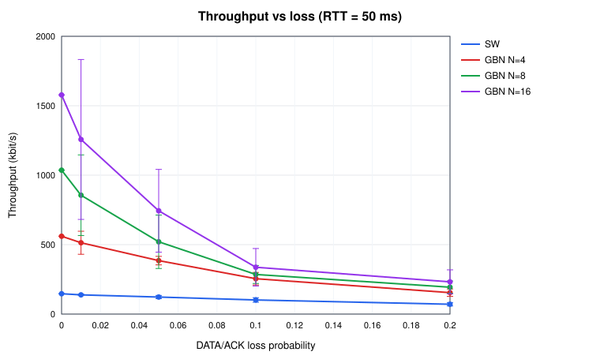
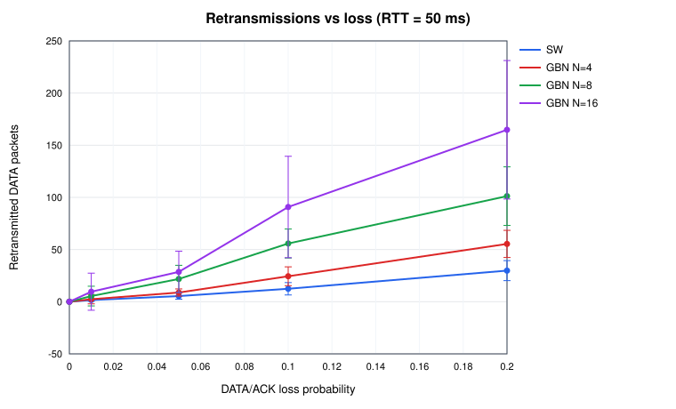
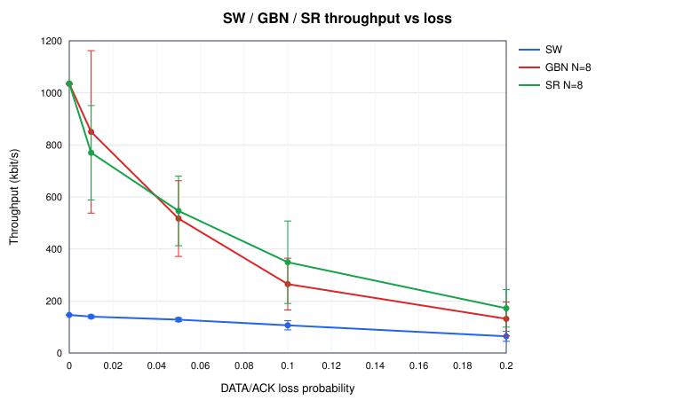
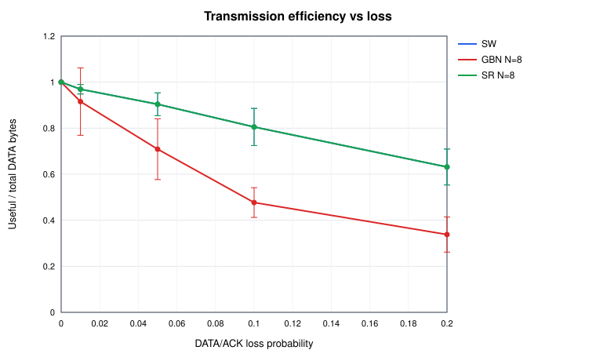
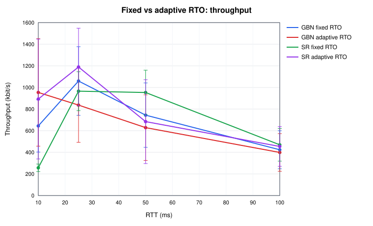
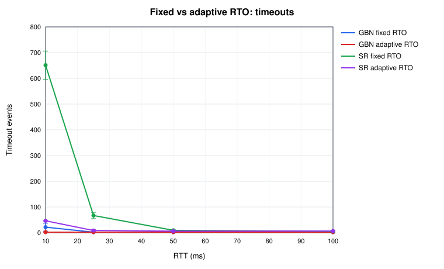
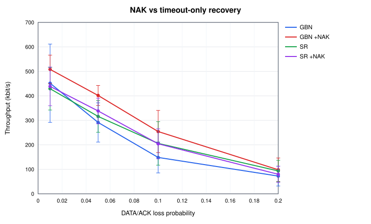
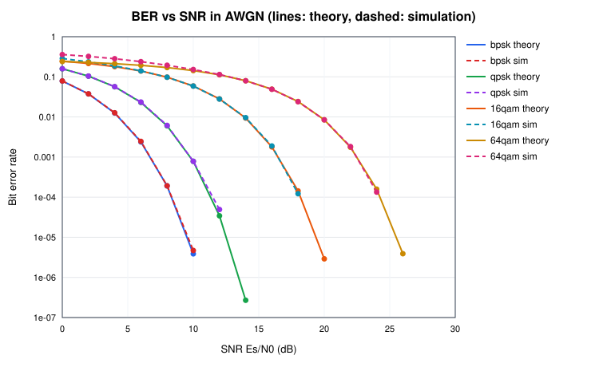
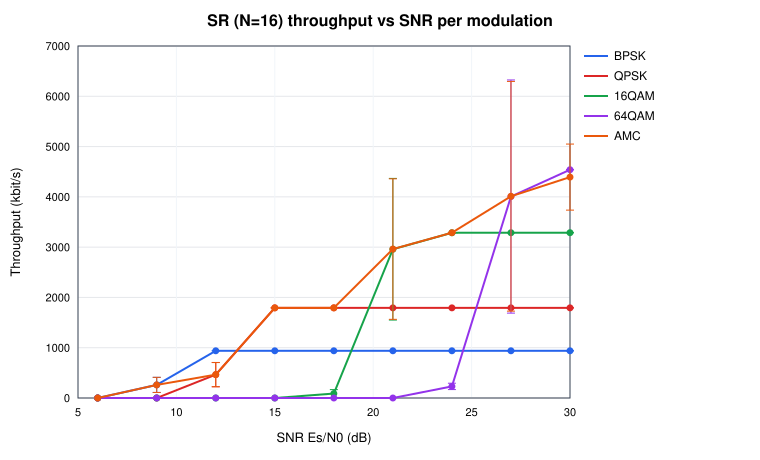
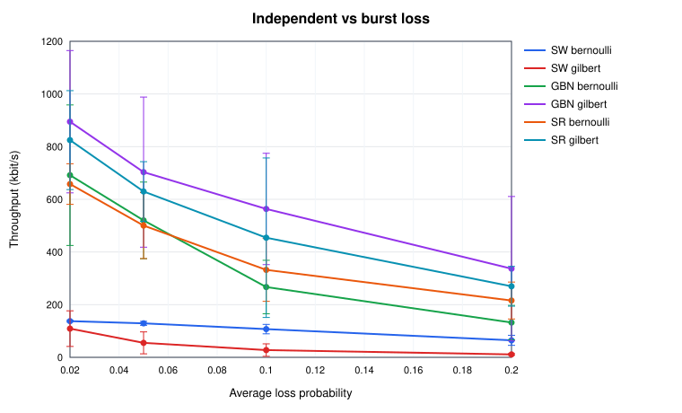

# Results and discussion

All numbers come from the CSV files in [`results/`](../results). They were produced on one machine
(Windows 11, 16 hardware threads, loopback UDP) with a single command:

```bash
arqsim sweep --preset all --out results        # 1 025 runs, ~7.5 min with 8 parallel workers
```

Common settings, unless a section says otherwise:

* file: 50 000 bytes of pseudo-random data, split into 50 DATA packets with a 1000-byte payload and a 14-byte header (`L` = 1014 B)
* link rate: `R` = 2 Mbit/s, so `L/R` = 4.06 ms
* DATA loss equals ACK loss
* 5 repetitions per configuration. Repetition *r* uses the same seed for every protocol, so all protocols see the same randomness.
* error bars and `±` values are 95 % Student-t confidence intervals

Every run was checked end to end: the received size and the SHA-256 had to match the original.
**No completed transfer ever delivered a corrupted file (0 of 935).**
All 90 runs that did not complete are modulation/SNR pairs below the SNR cliff (§5): there the frame error rate is about 1, and the run aborts after 10 s without progress.

---

## 1. The proposal's experiment matrix (`results/proposal`, 400 runs, fixed RTO = 2×RTT)

### 1.1 Loss-free channel: measured vs theoretical utilisation


| Protocol | RTT 10 ms | RTT 50 ms | RTT 100 ms | RTT 200 ms |
|---|---|---|---|---|
| SW (meas / eq. 1)      | 0.284 / 0.289 | 0.075 / 0.075 | 0.039 / 0.039 | 0.020 / 0.020 |
| GBN N=4 (meas / eq. 2) | 0.951 / 1.000 | 0.285 / 0.300 | 0.149 / 0.156 | 0.076 / 0.080 |
| GBN N=8                | 0.951 / 1.000 | 0.528 / 0.600 | 0.276 / 0.312 | 0.141 / 0.159 |
| GBN N=16               | 0.951 / 1.000 | 0.801 / 1.000 | 0.481 / 0.624 | 0.247 / 0.318 |

* **Stop-and-Wait matches equation (1) within 2 %.** The confidence intervals are below 0.5 %, so the emulator's timing is accurate.
* **GBN follows equation (2) and saturates once `N·L/R ≥ RTT + L/R`.**
  The remaining gap comes from the finite file. Eq. 2 describes steady state, but a 50-packet transfer always pays one extra RTT for the last ACK.
  A finite-file model `T ≈ n·L/R + RTT` predicts 0.80 for N=16 at RTT = 50 ms, and we measured 0.801.
* At RTT = 10 ms all windows reach 0.95. The link is the bottleneck: 1.88 Mbit/s of goodput out of 2 Mbit/s, the difference being the 14-byte header.

### 1.2 Throughput vs RTT and window


SW throughput falls as `1/RTT`: 559 → 147 → 77 → 39 kbit/s.
At RTT = 200 ms, GBN with N=16 is **12.5×** faster than SW (487 vs 39 kbit/s).
Throughput grows with N until the window covers the bandwidth-delay product, as predicted by the proposal (§6).

### 1.3 Effect of loss (RTT = 50 ms)




| loss | SW kbit/s (retx) | GBN N=4 | GBN N=8 | GBN N=16 |
|---:|---|---|---|---|
| 0 %  | 147 (0)    | 563 (0)    | 1041 (0)   | 1580 (0) |
| 1 %  | 139 (1.6)  | 516 (2.4)  | 861 (5.4)  | 1259 (9.6) |
| 5 %  | 123 (5.4)  | 386 (8.8)  | 523 (21.8) | 746 (28.6) |
| 10 % | 102 (12.4) | 255 (24.4) | 285 (55.8) | 337 (90.8) |
| 20 % | 71 (29.8)  | 155 (55.4) | 194 (101)  | 232 (165) |

* GBN keeps a throughput advantage at every loss rate, but **the advantage shrinks from 10.7× to 3.3×**.
  The cost is efficiency: at 20 % loss, GBN N=16 sends 4.1 packets for every useful one (efficiency 0.245), while SW needs only 1.6 (efficiency 0.63).
* Larger windows waste more: one loss forces up to N−1 needless retransmissions.
* **A fixed RTO of 2×RTT ignores queueing.** For GBN N=16 at RTT = 10 ms, the queueing delay is `16·L/R ≈ 65 ms`, larger than the RTO of 20 ms.
  As a result, 1 % loss caused 128 retransmissions per transfer, compared with 9.6 at RTT = 50 ms. Section 3 studies this.

## 2. Three protocols: SW vs GBN vs SR (`results/protocols`, N = 8, RTT = 50 ms, adaptive RTO)




| loss | SW | GBN | SR | retransmissions SW / GBN / SR | efficiency SW / GBN / SR |
|---:|---:|---:|---:|---|---|
| 0 %  | 147 | 1040 | 1041 | 0 / 0 / 0 | 1 / 1 / 1 |
| 1 %  | 141 | 854  | 774  | 1.6 / 5.4 / **1.6** | 0.97 / 0.92 / **0.97** |
| 5 %  | 129 | 520  | 500  | 5.4 / 21.8 / **5.4** | 0.90 / 0.71 / **0.90** |
| 10 % | 107 | 267  | **333** (+25 %) | 12.4 / 55.8 / **12.4** | 0.81 / 0.48 / **0.81** |
| 20 % | 65  | 132  | **216** (+64 %) | 29.8 / 101 / **29.8** | 0.63 / 0.34 / **0.63** |

* Selective Repeat retransmits **exactly the lost packets**: as few as Stop-and-Wait, and 4.5× fewer than GBN at 10 % loss. Its efficiency equals SW's, while it keeps a pipelined window.
* At low loss (≤ 5 %), GBN and SR have the same throughput within the confidence intervals.
  As loss rises, GBN's redundant go-backs fill the link, and **SR pulls ahead by 25 % at 10 % loss and 64 % at 20 % loss**.
* The price of SR is a receiver buffer and one logical timer per packet (see §3 for how the timers have to be run).

## 3. Fixed (2×RTT) vs adaptive (RFC 6298) RTO (`results/rto`, N = 16, loss 5 %)




| RTT | GBN fixed | GBN adaptive | SR fixed | SR adaptive |
|---:|---|---|---|---|
| 10 ms  | 634 (232 retx) | **956 (29)** | 816 (128 retx) | **1037 (5.4)** |
| 25 ms  | 1060 | 842 | 1177 (9.6) | 883 (5.4) |
| 50 ms  | 746  | 631 | 724 | 620 |
| 100 ms | 424  | 400 | 389 | 393 |

* When the queueing delay `N·L/R` (65 ms) exceeds `RTT`, the fixed RTO fires before the ACK can possibly arrive.
  The adaptive estimator measures the real, queue-inflated RTT and **cuts GBN's retransmissions by 88 % (+51 % throughput) and SR's by 96 %**.
* When queueing is small (RTT ≥ 25 ms), fixed 2×RTT performs as well or slightly better. It is effectively an oracle that already knows the RTT, whereas `SRTT + 4·RTTVAR` is deliberately conservative.
* Three implementation lessons came out of these experiments, and each is fixed in the code with its own commit:
  1. **Karn's rule vs GBN.** After a go-back, every packet in the window has been retransmitted, so GBN gets no new RTT samples. The exponential back-off therefore kept growing across unrelated losses, up to 4 s.
     Clearing the back-off whenever new data is acknowledged, as Linux does, raised GBN at 10 % loss from 40 to 265 kbit/s.
  2. **Cold start.** RFC 6298's initial RTO of 1 s dominates 50-packet transfers. The estimator is now seeded with a cached path RTT (initial RTO = 3·RTT), as Linux tcp_metrics does.
  3. **SR timers must follow the pipe, not the send call.** A textbook per-packet timer starts when the packet is handed to the link. On a slow link, a packet then waits `N·L/R` in the queue and times out before it has even been transmitted.
     The fix re-arms each timer whenever the window base advances (the RFC 6298 §5.3 rule, applied to every logical timer). A lost packet still times out one RTO after it reaches the head of the window.
     Effect: SR with BPSK went from 560 to 939 kbit/s (35 → 0 spurious retransmissions), and SR with a fixed RTO at RTT 10 ms went from 651 to 128 retransmissions.

## 4. NAK-triggered retransmission (`results/nak`, N = 8, RTT = 100 ms)



| loss | GBN | GBN + NAK | SR | SR + NAK |
|---:|---:|---:|---:|---:|
| 1 %  | 452 | **508** (+12 %) | 423 | 445 |
| 5 %  | 292 | **402** (+38 %) | 286 | 290 |
| 10 % | 149 | **254** (+71 %) | 197 | 208 |
| 20 % | 72  | **98** (+36 %)  | 129 | 106 |

NAKs let the sender react after about one RTT instead of waiting for a full RTO.
**GBN gains the most:** its timeouts drop from 7.6 to 1.4 per transfer at 10 % loss.
SR gains little: its receiver already ACKs every packet individually, so the sender knows exactly what is missing. At 20 % loss, NAKs that are themselves lost or late even cause duplicate retransmissions.

## 5. Physical layer: modulation over AWGN (`results/modulation`)

Settings: symbol rate 1 Mbaud, so `R` is 1, 2, 4 or 6 Mbit/s for BPSK, QPSK, 16-QAM and 64-QAM.
RTT = 20 ms, N = 16, no random packet loss: **every error comes from the PHY**.
There were 3 repetitions per point, and a run aborts if it makes no progress for 10 s.



The bit-level Monte-Carlo modem reproduces the closed-form BER. It agrees exactly for BPSK/QPSK, and for 16/64-QAM it is within a few percent wherever BER ≤ 10⁻².
At very low SNR the nearest-neighbour approximation underestimates the QAM BER, as expected.
This is also checked by an automated test.




Goodput (kbit/s); "–" means the transfer could not complete:

| SNR (dB) | BPSK | QPSK | 16-QAM | 64-QAM | **AMC** (choice) — GBN | AMC — SR |
|---:|---:|---:|---:|---:|---|---|
| 6  | –   | –    | –    | –    | – (BPSK) | – |
| 9  | 154 / 261 | – | – | – | 154 (BPSK) | 261 |
| 12 | 939 | 201 / 465 | – | – | 202 (QPSK) | 465 |
| 15 | 939 | 1793 | –    | –    | **1793** (QPSK) | 1793 |
| 21 | 939 | 1793 | 2773 / 2958 | – | **2775** (16-QAM) | 2962 |
| 24 | 939 | 1793 | 3286 | – / 231 | **3287** (16-QAM) | 3287 |
| 27 | 939 | 1793 | 3286 | 3883 / 4006 | **3891** (64-QAM) | 4011 |
| 30 | 939 | 1792 | 3287 | 4540 | **4544** (64-QAM) | 4393 |

(`a / b` = GBN / SR where they differ.)

* **SNR cliff.** A single bit error destroys a 8112-bit frame, so `FER = 1 − (1−BER)^8112` jumps from about 1 to about 0 within roughly 3 dB.
  Below the cliff ARQ cannot deliver at all: at a BER of 2·10⁻³, FER is above 0.99999.
* **Above the cliff, goodput follows `R = baud·log2 M`.** BPSK reaches 94 % of 1 Mbit/s, QPSK 90 % of 2 Mbit/s and 16-QAM 82 % of 4 Mbit/s.
  64-QAM reaches 76 % of 6 Mbit/s; the faster the link, the larger the share of the fixed final RTT in a 50-packet transfer (§1.1).
* **The ARQ/PHY trade-off.** Higher-order modulation is up to 4.8× faster, but only when the SNR is high enough.
  A wrong fixed choice either wastes capacity (BPSK at 30 dB: 939 instead of 4 540 kbit/s) or delivers nothing at all (64-QAM below 24 dB).
* **AMC** picks the scheme that maximises `log2 M · (1 − FER)` from the theoretical BER (see `arqsim amc`).
  It lands on the upper envelope of the four curves at every SNR, within the CI of the best fixed scheme.
  At 12 dB AMC chooses QPSK because the closed-form FER says QPSK is better. The measurement shows BPSK would have been better there, which illustrates how a model-based AMC can be wrong right at a cliff edge.
* **SR is better on the cliff edge.** At FER ≈ 20–25 %, SR delivers 1.7–2.3× more than GBN (BPSK 9 dB: 261 vs 154; QPSK 12 dB: 465 vs 201).
  At 18 dB with 16-QAM, SR even completes transfers that GBN cannot finish, because every GBN go-back re-sends frames that will most likely be corrupted again.
  Above the cliff the two protocols are identical.

## 6. Independent vs burst loss (`results/burst`)

N = 8, RTT = 50 ms, adaptive RTO. The Gilbert–Elliott model has the **same average loss rate** as the Bernoulli model, with a mean burst length of 4 packets.



| avg loss | SW iid → burst | GBN iid → burst | SR iid → burst |
|---:|---|---|---|
| 2 %  | 137 → 109 | 692 → **895** | 658 → **825** |
| 5 %  | 129 → 55  | 520 → **703** | 500 → **630** |
| 10 % | 107 → 28 (−74 %) | 267 → **563** (+111 %) | 332 → **454** (+37 %) |
| 20 % | 65 → 11 (−83 %)  | 132 → **337** (+155 %) | 216 → **270** (+25 %) |

The same average loss affects the protocols in opposite ways:

* **Stop-and-Wait collapses under bursts.** Its retransmissions of the same packet fall into the same burst.
  Each consecutive loss doubles the RTO, so a burst of k losses costs about `(2^k − 1)·RTO`.
* **The windowed protocols benefit from bursts.** Losses clustered into a few events mean fewer separate recovery episodes:
  * GBN pays one go-back per burst instead of one per loss. At 10 % loss it needs only 19 retransmissions instead of 56.
  * SR recovers all packets of a burst in parallel, within one timeout.

Independent-loss experiments therefore **overestimate SW and underestimate the windowed protocols** on real bursty links such as wireless fading channels.

## Emulation accuracy

The committed results above predate the delivery-lateness metric (`late_mean_ms`, `late_max_ms`, added in arqsim 1.1). To measure how faithfully the emulator reproduced the configured delays, the full study was run **once more, separately**: same Windows machine, same command, 8 parallel workers, 460 s.
That run is **not** committed. `results/` is unchanged and still matches the report.

**Delivery lateness** (how much later than scheduled the channel released a packet), over the 935 completed runs:

| Preset | Completed runs | Mean | Median | Worst run (mean) | Runs with mean < 0.1 ms |
|--------|---------------:|-----:|-------:|-----------------:|------------------------:|
| proposal | 400 | 0.015 ms | 0.002 ms | 0.71 ms | 97 % |
| protocols | 75 | 0.007 ms | 0.002 ms | 0.11 ms | 99 % |
| modulation | 180 | 0.018 ms | 0.002 ms | 1.31 ms | 98 % |
| rto | 80 | 0.050 ms | 0.002 ms | 1.11 ms | 90 % |
| burst | 120 | 0.006 ms | 0.002 ms | 0.15 ms | 99 % |
| nak | 80 | 0.020 ms | 0.002 ms | 0.28 ms | 92 % |
| **all** | **935** | **0.017 ms** | **0.002 ms** | **1.31 ms** | **96.7 %** |

The 95th and 99th percentiles of the per-run mean are 0.06 ms and 0.30 ms. Isolated deliveries were occasionally late by up to 43 ms (an OS preemption), but these are rare enough that no run's mean exceeded 1.3 ms. The emulator's spin window stayed at its 16 ms minimum in 926 of the 935 runs.
Compared with the delays being emulated (`L/R` = 4.06 ms, RTT 10–200 ms), the timing error is negligible.

**Reproducibility.** `arqsim conclude` on the fresh run gives the same verdict and the same conclusions as on `results/`. The numbers differ only slightly:

| Finding | `results/` | fresh run |
|---------|-----------:|----------:|
| SW utilisation vs theory (worst RTT) | within 1.8 % | within 3.2 % |
| GBN (N=16) vs SW at RTT 200 ms | 486.8 vs 39.2 kbit/s (12.4×) | 486.4 vs 39.1 kbit/s (12.4×) |
| SR / GBN / SW at 20 % loss | 215.9 / 132.1 / 64.6 kbit/s | 214.5 / 131.9 / 64.4 kbit/s |
| Adaptive vs fixed RTO, worst case | −96 % retransmissions | −96 % retransmissions |
| 64-QAM / AMC peak | 4 540 / 4 393 kbit/s | 4 523 / 4 371 kbit/s |
| Completed / corrupted / aborted runs | 935 / 0 / 90 | 935 / 0 / 90 |

**Other platforms.** These figures are for Windows, and Linux CI runners give the same picture. On macOS, the scheduler preempts the emulator while it waits for the next delivery. With windowed protocols this leaves deliveries several milliseconds late on average: 6–9 ms for GBN/SR at RTT 50 ms on GitHub's macOS runners. Results produced on macOS should therefore be checked with `late_mean_ms` before being compared with these numbers (see the README's platform notes).

## Threats to validity

* All processes share one host and the loopback interface. CPU scheduling jitter of about 1 ms is absorbed by the 5 ms timer granularity and the emulator's spin-wait.
  Running 8 experiments in parallel did not change the results: SW at RTT 10 ms gives 557 kbit/s in parallel vs 552 serially.
  The emulator's delivery lateness was measured directly in a separate full run: 0.017 ms on average (see [Emulation accuracy](#emulation-accuracy)).
* Transfers are 50 packets long, so start-up and tail effects matter. They are part of the reported numbers, and §1.1 quantifies them.
* With 5 repetitions the confidence intervals under loss are wide (±20–40 %). Conclusions are only drawn where the intervals do not overlap or where the trend holds across all settings.
